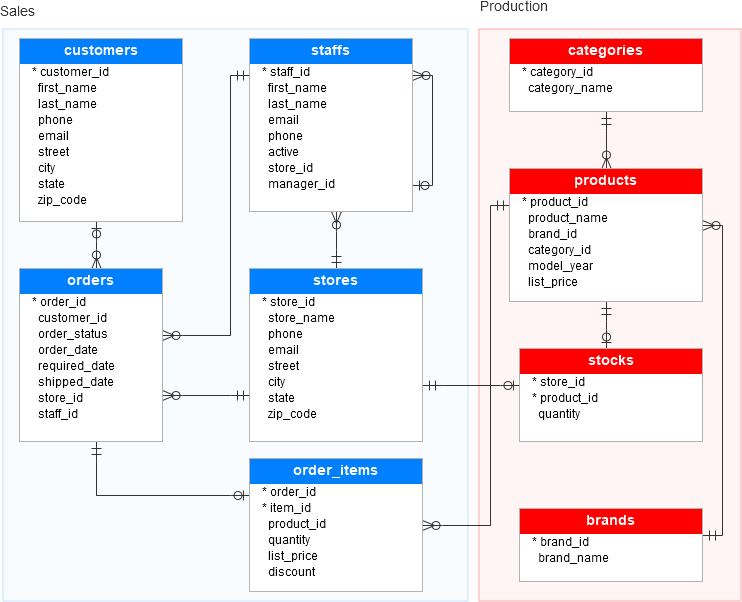

# Bicycle Store Sales Analysis (SQL)

End-to-end SQL analysis of a multi-store bicycle retailer: relational schema setup, data integrity enforcement, and business-driven queries on revenue, customers, products, staff, and inventory.

 

---

## Table of Contents
- [Problem Statement](#problem-statement)
- [Dataset Description](#dataset-description)
- [Database Schema](#database-schema)
- [Repository Structure](#repository-structure)
- [SQL Understanding](#sql-understanding)
- [Analysis Performed](#analysis-performed)
- [How to Run](#how-to-run)
- [Key Takeaways](#key-takeaways)

---

## Problem Statement

A bicycle retailer operating multiple stores wants to move from raw transactional data to actionable decisions. Management needs answers to questions across five areas:

| Area | Business Question |
|---|---|
| **Geography** | Which regions are most profitable per order? Where should we expand or advertise? |
| **Products** | Which brands, categories, and individual products drive revenue? |
| **Stores** | Which stores underperform, and which need urgent restocking? |
| **Staff** | Which employees drive the most revenue and deserve recognition or training? |
| **Inventory** | Which products are out of stock, and at which stores? |

**Objective:** Use SQL to build a clean relational model and answer each question with reproducible, revenue-accurate queries.

---

## Dataset Description

Nine CSV files form a normalized sales and production database covering orders from **January 2016 to December 2018**.

| Table | Schema Group | Rows | Description |
|---|---|---|---|
| `customers` | Sales | 1,445 | Customer contact and location details (street, city, state, zip) |
| `orders` | Sales | 1,615 | Order header: customer, status, order/required/shipped dates, store, staff |
| `order_items` | Sales | 4,722 | Line items: product, quantity, list price, discount |
| `staffs` | Sales | 10 | Employees with store assignment and manager hierarchy |
| `stores` | Sales | 3 | Store contact and location details |
| `products` | Production | 321 | Product name, brand, category, model year, list price |
| `categories` | Production | 7 | Product types (e.g., mountain, road bikes) |
| `brands` | Production | 9 | Brand lookup |
| `stocks` | Production | 939 | Quantity on hand per store and product |

**Footprint:** 3 stores across 3 states (NY, CA, TX). Customers are heavily concentrated in New York (1,019 of 1,445).

**Revenue definition used throughout:**

```
revenue = quantity × list_price × (1 − discount)
```

---

## Database Schema



The schema is split into two domains:

- **Sales:** `customers`, `orders`, `order_items`, `staffs`, `stores`
- **Production:** `products`, `categories`, `brands`, `stocks`

Key relationships:
- One customer → many orders; one order → many order items
- Each order belongs to one store and is handled by one staff member
- Staff are tied to a store and self-reference through `manager_id`
- Each product belongs to one brand and one category
- `stocks` is a many-to-many bridge between stores and products (composite key)

---

## Repository Structure

```
├── basic.sql                         # Database creation, primary keys, foreign keys
├── analysis.sql                      # Business analysis queries
├── data/                             # Source CSVs (brands, categories, customers, order_items,
│                                     #   orders, products, staffs, stocks, stores)
├── Bicycle_store_server_database.png # ER diagram
└── README.md
```

---

## SQL Understanding

### 1. Schema and Integrity (`basic.sql`)

| Concept | Usage |
|---|---|
| `CREATE DATABASE` / `USE` | Initializes the `bicycle_sales_db` workspace |
| `ALTER TABLE ... ADD PRIMARY KEY` | Defines unique identifiers on 7 tables (brands, categories, customers, orders, products, staffs, stores) |
| `ALTER TABLE ... ADD CONSTRAINT ... FOREIGN KEY` | Enforces referential integrity across orders, order_items, products, staffs, and stocks |
| Bulk constraint definitions | Multiple foreign keys added per `ALTER TABLE` statement |

Loading data first and adding constraints afterward validates that the imported data is consistent: any orphaned record would cause the constraint to fail.

### 2. Query Techniques (`analysis.sql`)

| Technique | Where Used | Purpose |
|---|---|---|
| Multi-table `JOIN` (up to 4 tables) | Q1, Q4–Q9 | Connect sales, product, and store dimensions |
| `SUM()` over a computed expression | Q1, Q4–Q8 | Net revenue after discount |
| `COUNT(DISTINCT ...)` | Q1 | Avoid double-counting orders that have multiple line items |
| `GROUP BY` (single and multi-column) | All | Aggregate by state, store, brand, category, staff |
| `ORDER BY` + `LIMIT` | Q3, Q5 | Top-N rankings |
| `ROUND()` / `CONCAT()` | Q1, Q4–Q8 | Presentation-ready currency formatting |
| Derived table (subquery in `FROM`) | Q9 | Isolate out-of-stock rows before counting per store |
| `WHERE` filtering | Q9 | Filter on zero stock and a specific store |

---

## Analysis Performed

### Q1. Regional profitability per order
**Question:** Which regions earn the most per order, and where should marketing or expansion focus?
**Approach:** Join `stores → orders → order_items`, divide total net revenue by `COUNT(DISTINCT order_id)` to get average revenue per order by state and store.
**Why it matters:** Average order value normalizes for volume, showing which markets deliver higher-value transactions.

### Q2. Customer concentration by state
**Question:** Where should new stores or advertising be focused?
**Approach:** Count customers grouped by state.
**Finding:** Customers are concentrated in New York (1,019), followed by California (284) and Texas (142).

### Q3. Customer concentration by zip code
**Question:** Which specific areas hold the densest customer bases?
**Approach:** Count customers by `zip_code` and `state`, return the top 20.
**Why it matters:** Enables hyperlocal targeting beyond state-level analysis.

### Q4. Brand revenue ranking
**Question:** Which brands drive revenue and deserve better in-store placement?
**Approach:** Join `brands → products → order_items`, sum net revenue per brand, express in thousands.

### Q5. Top 10 best-selling products
**Question:** Which products should be bundled or featured?
**Approach:** Rank products by total units sold, with revenue as a tiebreaker.

### Q6. Category performance
**Question:** Which product types are most popular, and should inventory be adjusted?
**Approach:** Join `categories → products → order_items`, rank categories by net revenue.

### Q7. Staff revenue contribution
**Question:** Which staff members should be rewarded or trained?
**Approach:** Join `staffs → orders → order_items` and `stores`, aggregate revenue per employee with store context.

### Q8. Store performance ranking
**Question:** Which stores underperform, and should we consider promotions, openings, or closures?
**Approach:** Aggregate net revenue per store and rank descending to surface the weakest performer.

### Q9. Stock risk by store
**Question:** Which stores need immediate attention on inventory?
**Approach:**
1. Subquery isolates product-store pairs where `quantity = 0`.
2. Outer query counts out-of-stock products per store and state.
3. A follow-up query lists the exact out-of-stock products for a chosen store (e.g., Santa Cruz Bikes).

---

## How to Run

**Requirements:** MySQL 8.0+ (or compatible), MySQL Workbench or CLI.

```sql
-- 1. Create the database and import each CSV into a table of the same name
--    (MySQL Workbench: right-click schema → Table Data Import Wizard)

-- 2. Apply keys and constraints
SOURCE basic.sql;

-- 3. Run the analysis
SOURCE analysis.sql;
```

> **Note:** Import all nine CSVs before running the constraint statements in `basic.sql`; foreign keys require the referenced tables to exist and be populated.

---

## Key Takeaways

- **Revenue accuracy:** Every revenue metric applies discounts at line-item level rather than using list price alone.
- **Order-level metrics:** `COUNT(DISTINCT order_id)` prevents inflated denominators caused by multi-item orders.
- **Decision-oriented design:** Each query is mapped to a concrete business action (expand, promote, restock, reward, retrain).
- **Data integrity first:** Primary and foreign keys were applied after loading, validating the dataset's relational consistency.